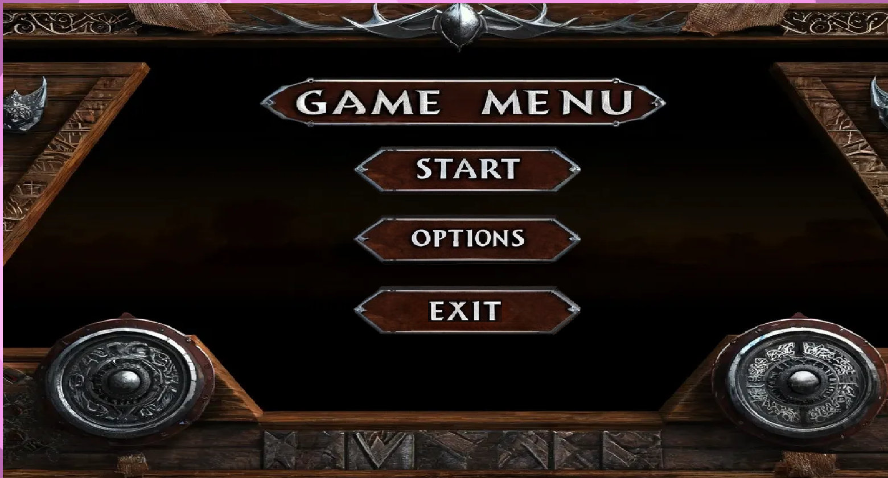
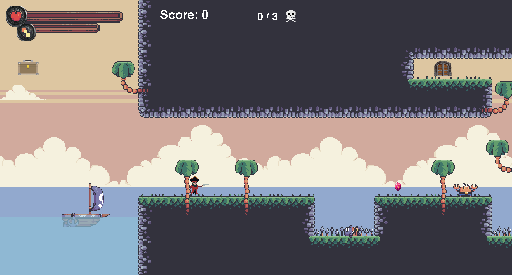

# Viking Hunter

2D side-scrolling platformer in plain Java (AWT/Swing, no game library). Three levels, three kinds of monsters, items to collect and a key to the next level.




## What it does

- Three monsters: Crabby (50 HP, 15 damage), Pinkstar (60 HP, 20 damage) and Shark (60 HP, 15 damage). From level 2, cannons fire 25-damage balls. Water and spikes kill instantly.
- The player has 100 HP and a sword that deals 20 damage for 20 points. A dash costs 60 of the 200-point power bar, which refills over time.
- Red potions give 20 HP, blue ones 15 HP. Boxes and barrels drop one when hit.
- Inventory of 5 items, 4 in use at once. Item A kills the next monster hit and takes its health. B disarms spikes, C opens the NPC's inventory, D ends the game, E steals from it.
- A level ends with the key and door or by killing every monster, tracked by a skull counter. Keys (AZERTY): Q / D move, Z jump, Space attack, R dash, Esc pause, I inventory.

## How it works

A game thread runs 200 logic updates and 120 Java2D repaints per second. The window is 26 x 14 tiles of 32 px scaled by 1.88, so 1560 x 840. Levels are PNG files, one pixel per tile: red is the tile index, green places entities, blue places objects. The camera scrolls past 25 % or 75 % of the screen; collisions test the four corners of a hitbox against the tile grid.

## Run it

Java 17 or newer, run from the project root so the assets in `res/` are found.

```bash
javac -d bin $(find src -name "*.java")
java -cp "bin:res" main.MainClass          # Linux / macOS
java -cp "bin;res" main.MainClass          # Windows
```

## Limitations

- `Playing` pre-fills the inventory (key, items A, C, D, E) for the demo, so the 5-slot limit refuses items found in the level. Remove the `initializePlayerInventory()` call to fix it; `addTemporarySkipLevelObject()` also drops a test door at the start of level 1.
- Enemy sight and attacks are horizontal only, so monsters cannot follow you across platforms.
- Options only has a god-mode checkbox, debug prints remain and there are no tests.

Individual project for the Java / object-oriented programming module at CY Tech, spring 2024; the French game guide is in [docs/Guide_de_Jeu.pdf](docs/Guide_de_Jeu.pdf). Game loop, tile collisions, PNG levels, three enemies and Pixel Frog's sprites follow [Kaarin Gaming](https://www.youtube.com/@KaarinGaming)'s [Java 2D platformer tutorial](https://www.youtube.com/watch?v=6_N8QZ47toY&list=PL4rzdwizLaxYmltJQRjq18a9gsSyEQQ-0), which I followed episode by episode. I added the inventory and items, the NPC and steal mechanic, the key-and-door exit, kill counter and score, god mode, music and the AZERTY mapping.
