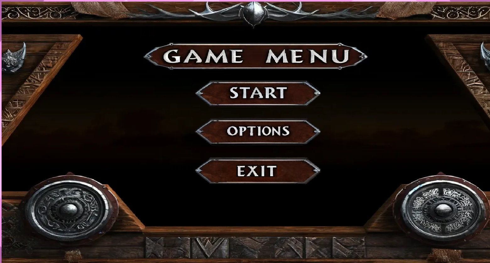
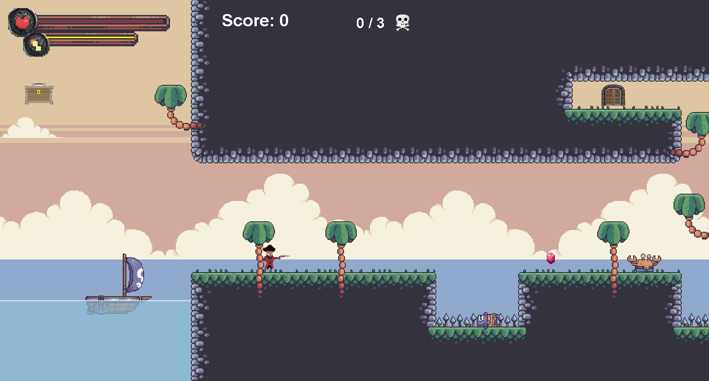

# Viking Hunter (Legends of the North)

A 2D side-scrolling platformer written in plain Java (AWT/Swing, no game library), made for the
Java / object-oriented programming module at CY Tech in spring 2024. You run, jump and fight your
way through three levels, deal with three kinds of monsters, pick up items, and find the key that
opens the door to the next level. The game guide I handed in with the project (in French) is in
[docs/Guide_de_Jeu.pdf](docs/Guide_de_Jeu.pdf).

The engine skeleton (fixed-step game loop, tile collisions, levels drawn as PNG files, the three
enemies and their state machines, the pirate sprites from Pixel Frog's free pack) follows Kaarin
Gaming's Java 2D platformer tutorial series. What I built on top of it: the inventory and the five
items with their effects, the NPC with its own inventory and the steal mechanic, the key-and-door
exit, the kill counter and score, the god-mode option, the background music and the AZERTY key
mapping.




## Controls

- `Q` / `D`: move left / right, `Z`: jump (AZERTY layout)
- `Space`: attack; it also opens boxes and barrels
- `R`: special dash attack. It costs 60 of the 200 points of the yellow power bar, which refills
  over time
- `Esc`: pause / resume
- `I`, or the chest button in the top-left corner: open or close the inventory
- Mouse: menu buttons; click an item in the inventory to select it (up to 4 selected at once);
  click the NPC to open its inventory (requires Item C to be selected)
- Numpad `1` / `2`: steal the first or second item of the NPC (requires Item E to be selected)

## Rules

- The player has 100 HP. A sword hit deals 20 damage and gives 20 points of score.
- Crabby (50 HP, 15 damage) walks and attacks when you are on its row within one tile. Pinkstar
  (60 HP, 20 damage) rolls at you when it sees you. Shark (60 HP, 15 damage) dashes during its
  attack. From level 2 on, cannons fire a 25-damage ball when you are on their row and in front of
  them. Water and spikes kill instantly.
- Red potions give 20 HP, blue ones 15 HP. Boxes and barrels drop a potion when you hit them.
- The key opens the door to the next level. Killing every monster of a level also completes it;
  the skull counter at the top shows the progress.
- Items: A kills the next monster you hit outright and gives you its remaining health; B makes
  spikes harmless; C is consumed to open the NPC's inventory; D ends the game and rolls the
  credits; E lets you steal from the NPC. The inventory holds 5 items, 4 of which can be in use.
- Options has a god-mode checkbox: the player stops taking damage from monsters and objects
  (water still kills).

## How it is built

```
src/
  main/        MainClass (entry point), Game (loop), GamePanel (JPanel), GameWindow (JFrame)
  gamestates/  Gamestate enum, State/Statemethods, Menu, Playing, GameOptions, Credits
  entities/    Entity, Player, Enemy, Crabby, Pinkstar, Shark, EnemyManager, NPC
  levels/      Level (parses a PNG into tiles, entities and objects), LevelManager
  objects/     GameObject and subclasses: Potion, GameContainer, Spike, Cannon, Projectile,
               Key, ItemA..ItemE, SkipLevelObject (the door), BackgroundTree, Grass; ObjectManager
  ui/          overlays and buttons: pause, level completed, game over, game completed,
               inventory, NPC inventory, cheat checkbox
  inputs/      KeyboardInputs, MouseInputs (forward events to the current state)
  effects/     Rain, DialogueEffect (the "!" and "?" bubbles above monsters)
  audio/       AudioPlayer (javax.sound.sampled Clip, loops the music)
  utilz/       Constants, HelpMethods (collision tests), LoadSave (sprite atlases, levels)
res/           sprite atlases, levels (lvls/1.png, 2.png, 3.png), UI images, music
```

`Game` runs its own thread with two accumulators: 200 logic updates per second and 120 repaints
per second. `update()` and `render()` dispatch on the static `Gamestate.state`, and `GamePanel`
calls `Game.render(g)` from `paintComponent`. Everything is drawn with Java2D; sprites are cut
out of atlases with `getSubimage`. The window is 26 x 14 tiles of 32 px scaled by 1.88, so
1560 x 840.

Levels are PNG files where each pixel is a tile: the red channel is the tile index in
`outside_sprites.png` (48 and 49 are water), the green channel places entities (0 Crabby,
1 Pinkstar, 2 Shark, 3 NPC, 100 player spawn) and the blue channel places objects (potions, box,
barrel, spike, cannons, trees, 11 door, 12 key, 13 to 16 items A to D). Adding a level means
drawing a new PNG. The camera (`xLvlOffset`) scrolls when the player crosses 25 % or 75 % of the
screen; the two cloud layers move at 0.3 and 0.7 of that speed. Collisions test the four corners of
a hitbox against the tile grid (`CanMoveHere`, `IsEntityOnFloor`); enemies use `IsSightClear` to
check that the floor between them and the player is walkable before charging. Player and enemies
are small state machines (IDLE, RUNNING, ATTACK, HIT, DEAD) driven by the animation index.

## Build and run

Java 17 or newer (the code uses switch expressions). From the project root:

```
javac -d bin $(find src -name "*.java")
java -cp "bin:res" main.MainClass          # Linux / macOS
java -cp "bin;res" main.MainClass          # Windows
```

On Windows without `find`: `dir /s /b src\*.java > sources.txt` then `javac -d bin @sources.txt`.
`res/` must be on the classpath because sprites and levels are loaded with `getResourceAsStream`.
The music is read from the file `res/audio/background_music.wav` relative to the working
directory, so run from the project root; without the file the game starts in silence.

To get a single runnable jar:

```
jar cfe viking-hunter.jar main.MainClass -C bin . -C res .
java -jar viking-hunter.jar
```

The sources compile cleanly with JDK 17. In Eclipse, import the folder as a Java project with
`src` and `res` as source folders.

## Known issues and what I would change

- `Playing` pre-fills the inventory (key, items A, C, D, E) at start. I left that in for the exam
  demo; with the 5-slot limit, items found in the level are then refused. Removing the call to
  `initializePlayerInventory()` restores normal pickups.
- A test door is spawned near the start of level 1 by `addTemporarySkipLevelObject()`.
- The options screen only has the god-mode checkbox; the sound and volume controls of the
  tutorial base were removed and their sprites are not shipped.
- Enemy sight and attacks are horizontal only, so monsters cannot follow you across platforms.
- Lots of `System.out` debug prints are still there, and there are no tests.
- The music is a WAV because `javax.sound` only reads uncompressed audio; I down-sampled it to
  22 kHz mono to keep the repository small.

## Context

Individual project for the Java / object-oriented programming module at CY Tech, delivered in
May 2024 with the game guide. Code additions, levels and guide by Haroun Joudi.
